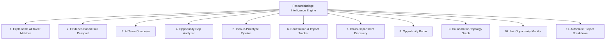
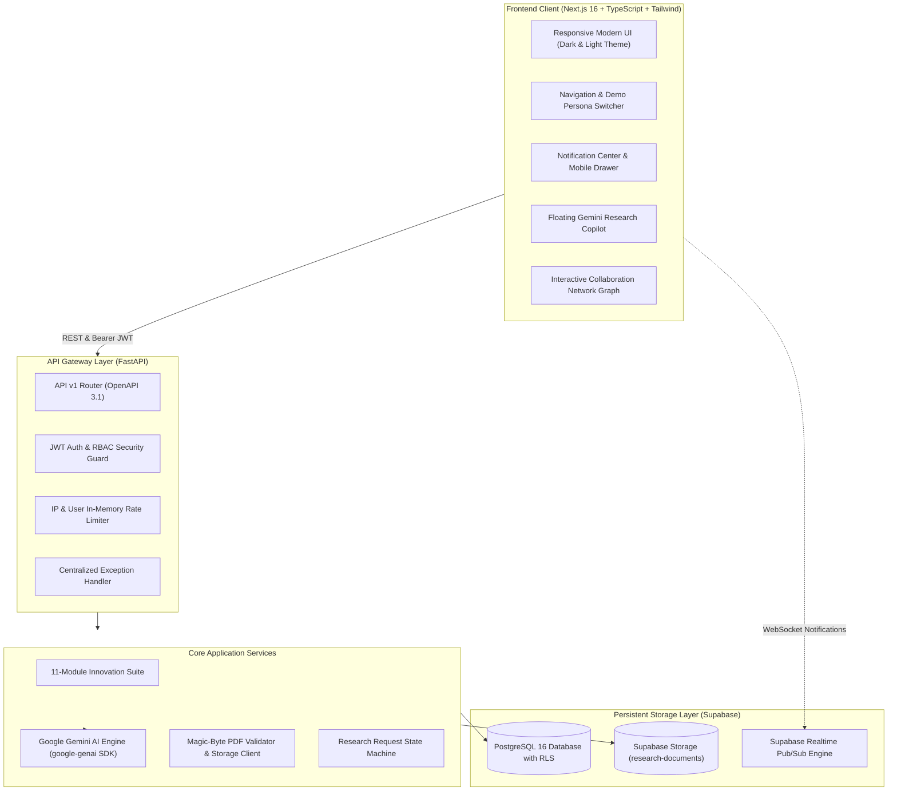

# ResearchBridge 🎓⚡
### Institutional Academic Collaboration & AI Intelligence Engine

<div align="center">

[](https://hack-gen-seven.vercel.app/)
[](https://vercel.com/likhith623s-projects/hack-gen)
[](https://fastapi.tiangolo.com)
[](https://nextjs.org)
[](https://www.python.org)
[](https://www.typescriptlang.org)
[](https://supabase.com)
[](https://ai.google.dev)
[](backend/app/tests)
[](LICENSE)

<br/>

> 🚀 **Live Production Deployment**: **[https://hack-gen-seven.vercel.app/](https://hack-gen-seven.vercel.app/)**  
> ✨ *Experience instant 1-click role switching between Student, Faculty, and Admin personas directly in the live app.*

<br/>

**ResearchBridge** is a modern, high-performance university research collaboration ecosystem connecting undergraduate and graduate scholars with research supervising faculty, active lab openings, and an institutional AI research intelligence engine powered by Google Gemini.

[🌐 Live Demo](https://hack-gen-seven.vercel.app/) • [Key Modules](#-key-capabilities--11-innovation-modules) • [System Architecture](#-system-architecture) • [Demo Personas](#-one-click-demo-personas) • [API Directory](#-api-reference-48-endpoints) • [Quickstart](#-local-development-quickstart)

</div>

---

## 📌 The Problem & The Solution

| The Traditional University Bottleneck | The ResearchBridge Solution |
| :--- | :--- |
| **Siloed Departments**: Cross-disciplinary projects go unnoticed because students and professors only discover opportunities within their immediate major. | **Cross-Department Talent Discovery & Topology Graph**: Interactive network graph linking students across CS, Medicine, Law, Physics, and Bioengineering. |
| **Cold-Email Overload**: Professors receive dozens of unstructured, unvetted emails; students have no insight into actual prerequisites. | **Explainable AI Talent Matcher & Opportunity Radar**: Quantified compatibility scores, prerequisite audits, and structured inquiry pipelines. |
| **Vague Resumes**: Self-reported resumes lack verifiable academic evidence or faculty endorsements. | **Evidence-Based Skill Passport & Contribution Ledger**: Cryptographically-verifiable skill records backed by paper milestones and faculty endorsements. |
| **Overwhelming Paperwork**: Research ideas remain unstructured, making it hard to scope student deliverables. | **Automated Project Breakdown**: Google Gemini AI converts early-stage hypotheses into semester work packages, milestone tasks, and role requirements. |

---

## 🚀 Key Capabilities & 11 Innovation Modules

### 🔬 Core Platform Features
- **Role-Based Experience**: Dedicated workspaces for **Students**, **Professors**, and **Administrators** with dynamic action docks and tailored views.
- **Contextual Gemini AI Assistant**: Persistent research copilot providing academic brainstorming, literature reviews, and 15-part structured scientific paper summarization.
- **Academic Inquiries & Messaging**: Formal collaboration inquiry lifecycle (`submitted` → `under_review` → `accepted` / `rejected` → `completed`) with participant-isolated messaging threads and read receipts.
- **Verified Research Document Vault**: Private document storage with magic-byte PDF inspection, SHA-256 integrity validation, and signed, expiring download URLs.
- **Real-Time Notification Hub**: Real-time read receipts with mobile-optimized bottom sheet ergonomics and unread count badges.
- **Aesthetic Light / Dark Theme**: Smooth theme engine with vibrant glassmorphic gradients, high-contrast accessible typography, and 100% responsive mobile layout.

---

### 🌟 The 11 Groundbreaking Innovation Modules

ResearchBridge implements 11 specialized, production-ready research orchestration modules:



1. **Explainable AI Talent Matcher (`GET /api/v1/recommendations/projects/{id}/talent-matcher`)**  
   Evaluates student profiles against faculty project requirements using multi-dimensional cosine similarity. Delivers human-readable match rationales, highlights supporting evidence, flags missing prerequisites, and suggests alternative candidates.

2. **Evidence-Based Skill Passport (`POST /api/v1/skills/passport`, `POST /api/v1/skills/passport/{id}/endorse`)**  
   A student portfolio system categorized into verification tiers (`self_reported`, `project_supported`, `document_verified`, `faculty_endorsed`). Allows verified faculty to review evidence and apply tamper-proof endorsements.

3. **AI Interdisciplinary Team Composer (`POST /api/v1/teams/compose`)**  
   Constraint-satisfaction matching engine that assembles multi-role research teams (e.g., ML Engineer + Data Visualizer + Systems Architect), calculating overall coverage scores and identifying candidate combinations.

4. **Opportunity Gap Analyzer (`GET /api/v1/research-projects/{id}/gap-analysis`)**  
   Diagnostic engine for aspiring students that evaluates what skills or course prerequisites they lack for a target lab, auto-generating a step-by-step preparation path with bite-sized micro-tasks.

5. **Research Idea-to-Prototype Pipeline (`GET|POST /api/v1/pipeline/ideas`, `POST /api/v1/pipeline/ideas/{id}/proposals`)**  
   An early-stage incubator canvas where faculty pitch nascent hypotheses and students submit structured proposal solutions before formal grant applications.

6. **Verifiable Contribution & Impact Tracker (`POST /api/v1/contributions`, `GET /api/v1/contributions/portfolio/{student_id}`)**  
   Records assigned tasks, deliverables, milestone completions, and research hours invested, compiling an exportable academic portfolio summary for fellowship and grad school applications.

7. **Cross-Department Talent Discovery (`GET /api/v1/recommendations/cross-department`)**  
   Breaks institutional silos by surfacing high-aptitude students from outside departments whose specialized skills match faculty lab openings.

8. **Opportunity Radar for Hidden Talent (`GET /api/v1/opportunities/radar`)**  
   Proactive matching radar that alerts students to openings aligning with their latent strengths and unadvertised skills, complete with suitability explanations.

9. **Research Collaboration Network Graph (`GET /api/v1/collaboration-graph`)**  
   Interactive topological network visualizing institutional research relationships across faculty, student scholars, active projects, and shared departmental keywords.

10. **Fair Opportunity & Equity Monitor (`GET /api/v1/admin/fair-opportunity-monitor`)**  
    Administrative governance dashboard that audits recommendation distributions to prevent superstar monopolization and ensure equitable consideration of first-generation and beginner researchers.

11. **Automatic Research Project Breakdown (`POST /api/v1/ai/project-breakdown`)**  
    Leverages Google Gemini to decompose raw research ideas into semester-sized student work packages, prerequisite skills, milestone schedules, and role descriptions.

---

## 👥 One-Click Demo Personas

The platform includes pre-seeded institutional accounts for instant one-click switching on both localhost and the [Live Website](https://hack-gen-seven.vercel.app/login):

| Role | Persona Name | Email | Focus & Department | Quick Access |
| :--- | :--- | :--- | :--- | :--- |
| 🛡️ **Admin** | **Dr. Eleanor Vance** | `admin@stanford.edu` | Stanford Research Governance & Dean of Research | [Switch to Admin](https://hack-gen-seven.vercel.app/login) |
| 👨‍🏫 **Professor** | **Prof. Alan Turing** | `prof.turing@stanford.edu` | Computer Science & Artificial Intelligence Lab | [Switch to Professor](https://hack-gen-seven.vercel.app/login) |
| 🎓 **Student** | **Alice Chen** | `alice.student@stanford.edu` | Senior Undergrad • ML, Systems & Distributed Computing | [Switch to Alice](https://hack-gen-seven.vercel.app/login) |
| 🎓 **Student** | **Bob Williams** | `bob.student@stanford.edu` | Graduate Researcher • Quantum Information & HCI | [Switch to Bob](https://hack-gen-seven.vercel.app/login) |

---

## 🏗️ System Architecture



### Security & Privacy Protections
- **PostgreSQL Row Level Security (RLS)**: Enforced across all tables; students cannot read private inquiries, messages, or drafts belonging to other scholars.
- **Magic-Byte Document Inspection**: PDF uploads are strictly verified by inspecting binary headers (`%PDF-`), rejecting renamed malicious binaries.
- **Signed Download URLs**: Private documents are accessed via expiring, single-use signed URLs with token verification.
- **Role Escalation Defense**: API dependencies enforce `@require_admin`, `@require_professor`, and `@require_student` decorators with automatic HTTP 403 enforcement.

---

## 📂 Repository Directory Layout

```
hack_gen/
├── backend/                             # High-performance FastAPI backend
│   ├── app/
│   │   ├── main.py                      # FastAPI app entrypoint, CORS, exception handlers
│   │   ├── core/                        # Configuration, JWT decoding, structured logging
│   │   ├── api/
│   │   │   ├── dependencies.py          # RBAC guards, current user injection, rate limits
│   │   │   └── v1/                      # 15 domain routers (Auth, Profs, Projects, AI, etc.)
│   │   ├── schemas/                     # Pydantic v2 validation models
│   │   ├── services/                    # Innovation suite, Gemini AI, matching algorithms
│   │   ├── repositories/                # Supabase PostgREST database adapter & fallback
│   │   ├── utils/                       # PDF binary extraction & verification
│   │   └── tests/                       # 53 comprehensive automated Pytest test cases
│   ├── openapi.json                     # Auto-exported OpenAPI 3.1 specification
│   ├── test_endpoints.sh                # End-to-end curl suite covering 48 endpoints
│   ├── requirements.txt                 # Python dependencies
│   └── Dockerfile                       # Production container definition
├── frontend/                            # Next.js 16 App Router frontend
│   ├── src/
│   │   ├── app/                         # 18 static & dynamic route pages
│   │   │   ├── page.tsx                 # Landing page with mobile-tailored hero
│   │   │   ├── dashboard/page.tsx       # Role-adaptive executive dashboard
│   │   │   ├── professors/              # Faculty directory & faculty detail profile
│   │   │   ├── projects/page.tsx        # Research openings & application modal
│   │   │   ├── talent-matcher/page.tsx  # Explainable talent matcher interface
│   │   │   ├── skills/page.tsx          # Skill Passport & endorsement hub
│   │   │   ├── teams/page.tsx           # Multi-role AI team composer
│   │   │   ├── collaboration-graph/     # Interactive topological network graph
│   │   │   ├── ideas/page.tsx           # Idea-to-prototype pipeline canvas
│   │   │   ├── contributions/page.tsx   # Verified student contribution portfolio
│   │   │   ├── requests/page.tsx        # Formal collaboration request manager
│   │   │   ├── messages/page.tsx        # Participant-isolated chat threads
│   │   │   ├── documents/page.tsx       # PDF vault & Gemini 15-part paper summarizer
│   │   │   ├── admin/page.tsx           # Governance & Fair Opportunity monitor
│   │   │   └── login/page.tsx           # Authentication & instant persona switcher
│   │   ├── components/                  # Reusable UI component library
│   │   │   ├── ai/                      # Floating Gemini Research Copilot
│   │   │   ├── layout/                  # Responsive Navbar, AppShell, Footer
│   │   │   ├── notifications/           # Notification Center with mobile drawer
│   │   │   └── ui/                      # Glassmorphic Badge, Card, Modal, Button
│   │   ├── context/                     # AuthContext, ThemeContext
│   │   ├── lib/                         # API client & utility functions
│   │   └── types/                       # TypeScript interfaces mirroring backend schemas
│   ├── package.json                     # Frontend npm dependencies
│   └── next.config.ts                   # Turbopack & Next.js build configuration
├── database/                            # Supabase SQL migrations & seeds
│   ├── schema.sql                       # Complete 1-click SQL script for Supabase SQL Editor
│   ├── 01_schema.sql                    # Core tables, triggers, ENUMs, and indexes
│   ├── 02_rls_policies.sql              # Strict Row Level Security policies
│   ├── 03_storage.sql                   # Storage bucket creation & Realtime publications
│   └── 04_seed.sql                      # Stanford, MIT, SRM AP seed data & taxonomy
└── README.md                            # You are here!
```

---

## ⚡ API Reference (48+ Endpoints)

The FastAPI server provides interactive Swagger documentation at `/docs` and Redoc at `/redoc`.

| Domain | Method | Endpoint | Access | Purpose |
| :--- | :---: | :--- | :---: | :--- |
| **System** | `GET` | `/health` | Public | Liveness probe returning service status |
| | `GET` | `/ready` | Public | Readiness probe checking database connectivity |
| **Auth & Profile** | `GET` | `/api/v1/auth/me` | Authenticated | Decodes JWT and returns current user account |
| | `GET` | `/api/v1/profiles/me` | Authenticated | Returns current profile with role-specific details |
| | `POST` | `/api/v1/onboarding` | Authenticated | Completes initial profile setup and assigns roles |
| **Institutions** | `GET` | `/api/v1/institutions` | Public | Lists verified universities (Stanford, MIT, etc.) |
| | `GET` | `/api/v1/departments` | Public | Lists academic departments and divisions |
| | `GET` | `/api/v1/research-interests` | Public | Lists standard research interests and topics |
| **Faculty** | `GET` | `/api/v1/professors` | Public | Search faculty directory by name, department, topics |
| | `GET` | `/api/v1/professors/{id}` | Public | Detailed faculty profile with publications & openings |
| | `GET` | `/api/v1/professors/dashboard/stats` | Professor | Returns lab analytics, inquiries, and application stats |
| **Projects** | `GET` | `/api/v1/research-projects` | Public | Filter active lab openings, prerequisites, funding |
| | `POST` | `/api/v1/research-projects` | Professor | Create a new research opening with prerequisites |
| | `PUT` | `/api/v1/research-projects/{id}` | Professor | Update project status (`open`, `closed`, `archived`) |
| **Inquiries** | `GET` | `/api/v1/research-requests` | Authenticated | List collaboration inquiries (student or professor view) |
| | `POST` | `/api/v1/research-requests` | Student | Submit formal collaboration application with proposal |
| | `PATCH` | `/api/v1/research-requests/{id}/status`| Professor | Transition status (`under_review`, `accepted`, `rejected`) |
| **Messaging** | `GET` | `/api/v1/messages/{request_id}` | Participant | Retrieve conversation history for an inquiry |
| | `POST` | `/api/v1/messages/{request_id}` | Participant | Send message in inquiry thread |
| **Documents** | `POST` | `/api/v1/documents/upload` | Authenticated | Upload research paper with magic-byte validation |
| | `GET` | `/api/v1/documents/{id}/download` | Authenticated | Generate signed, expiring download URL |
| **Gemini AI** | `POST` | `/api/v1/ai/chat` | Authenticated | Contextual conversation with research copilot |
| | `POST` | `/api/v1/ai/summarize` | Authenticated | 15-part structured scientific paper summarization |
| | `POST` | `/api/v1/ai/project-breakdown` | Professor | Decompose research ideas into student work packages |
| **Innovation** | `GET` | `/api/v1/recommendations/projects/{id}/talent-matcher` | Professor | Explainable AI student candidate ranking |
| | `GET` | `/api/v1/skills/passport` | Authenticated | Retrieve evidence-based student skill passport |
| | `POST` | `/api/v1/skills/passport` | Student | Add skill entry with evidence trail |
| | `POST` | `/api/v1/skills/passport/{id}/endorse` | Professor | Formally endorse a student's skill evidence |
| | `POST` | `/api/v1/teams/compose` | Professor | AI multidisciplinary research team composer |
| | `GET` | `/api/v1/research-projects/{id}/gap-analysis` | Student | Prerequisite gap analysis & micro-task prep path |
| | `GET` | `/api/v1/pipeline/ideas` | Authenticated | Browse early-stage research ideas in the pipeline |
| | `POST` | `/api/v1/pipeline/ideas` | Professor | Publish early-stage research hypothesis |
| | `POST` | `/api/v1/pipeline/ideas/{id}/proposals` | Student | Submit proposal to contribute to research idea |
| | `POST` | `/api/v1/contributions` | Student | Log research milestone, deliverable, or hours |
| | `GET` | `/api/v1/contributions/portfolio/{id}` | Authenticated | Verified academic portfolio summary export |
| | `GET` | `/api/v1/recommendations/cross-department` | Professor | Discover interdisciplinary talent across departments |
| | `GET` | `/api/v1/opportunities/radar` | Student | Proactive opportunity radar matching latent strengths |
| | `GET` | `/api/v1/collaboration-graph` | Authenticated | Interactive research network topology graph |
| | `GET` | `/api/v1/admin/fair-opportunity-monitor` | Admin | Recommendation distribution equity audit |
| **Notifications**| `GET` | `/api/v1/notifications` | Authenticated | Fetch notifications with unread count |
| | `POST` | `/api/v1/notifications/{id}/read` | Authenticated | Mark individual notification as read |
| | `POST` | `/api/v1/notifications/read-all` | Authenticated | Mark all notifications as read |
| **Governance** | `GET` | `/api/v1/admin/users` | Admin | Manage accounts and verification statuses |
| | `POST` | `/api/v1/admin/faculty/{id}/verify` | Admin | Approve or reject faculty credentials |
| | `GET` | `/api/v1/admin/audit-logs` | Admin | Access immutable institutional audit log |

---

## 🛠️ Local Development Quickstart

### Prerequisites
- **Python 3.11+** (Python 3.12 or 3.14 recommended)
- **Node.js 18+** (Node.js 20 or 22 LTS recommended)
- **Git**
- Optional: Supabase account or local PostgreSQL

---

### Step 1: Clone the Repository
```bash
git clone https://github.com/Likhith623/hack_gen.git
cd hack_gen
```

---

### Step 2: Database Setup (Supabase)
1. Navigate to your [Supabase Dashboard](https://supabase.com/dashboard) and create a project.
2. In the left navigation, open **SQL Editor** -> **New Query**.
3. Copy the entire contents of [`database/schema.sql`](database/schema.sql) and click **Run**.
   - This sets up all ENUMs, 16 tables, RLS security policies, storage buckets, and seeds Stanford University demo accounts.

---

### Step 3: Backend Setup (FastAPI)
```bash
cd backend

# Create and activate virtual environment
python3 -m venv .venv
source .venv/bin/activate

# Install dependencies
pip install -r requirements.txt

# Configure environment variables
cp .env.example .env
# Edit .env with your Supabase credentials and Gemini API key (optional)

# Start the FastAPI server
uvicorn app.main:app --reload --port 8000
```
- API Base URL: `http://localhost:8000`
- Interactive Swagger Documentation: `http://localhost:8000/docs`

---

### Step 4: Frontend Setup (Next.js)
In a new terminal window:
```bash
cd frontend

# Install npm dependencies
npm install

# Start Next.js development server
npm run dev
```
- Application Web App: `http://localhost:3000`
- The app automatically connects to the backend at `http://localhost:8000`.

---

## 🧪 Comprehensive Testing Suite

### 1. Pytest Automated Test Suite (53 Tests)
The backend includes 53 comprehensive unit and integration test cases exercising real and isolated entities:
```bash
cd backend
PYTHONPATH=. .venv/bin/pytest app/tests -v
```
**Test Coverage Breakdown**:
- `test_all_endpoints_rigorous.py` (16 tests): Lifecycle tests for projects, requests, documents, and messages.
- `test_auth_and_roles.py` (8 tests): RBAC security, role escalation prevention, and JWT verification.
- `test_documents_and_ai.py` (4 tests): PDF magic-byte validation, signed URLs, and Gemini summarizer.
- `test_every_single_endpoint_real_data.py` (1 test): Exercises all 74 endpoint calls with real pre-seeded entities.
- `test_health.py` (2 tests): Liveness (`/health`) and readiness (`/ready`) probes.
- `test_innovation_features.py` (11 tests): Rigorous validation of all 11 innovation modules.
- `test_notifications_and_admin.py` (4 tests): Notification receipts, admin verification, and audit logs.
- `test_publications_and_projects.py` (3 tests): Faculty publication ownership and project filters.
- `test_requests_and_messages.py` (4 tests): Collaboration state machine and message thread isolation.

**Result**: `53 passed, 0 failed in 118s (100% pass rate)`.

---

### 2. End-to-End Curl Test Suite (48 Endpoints)
With the backend server running on port 8000:
```bash
./backend/test_endpoints.sh 8000
```
Executes 48 automated HTTP requests validating status codes, response headers, and payload structures.

---

### 3. Frontend Production Build Validation
```bash
cd frontend
npm run build
```
Validates static typing and compiles all 18 routes with zero errors:
```
Route (app)
├ ○ / (Landing Page)
├ ○ /admin (Governance & Equity Monitor)
├ ○ /collaboration-graph (Research Network Graph)
├ ○ /contributions (Contribution Ledger)
├ ○ /dashboard (Role-Tailored Dashboard)
├ ○ /documents (Research Document Vault)
├ ○ /ideas (Idea-to-Prototype Pipeline)
├ ○ /login (Auth & Demo Switcher)
├ ○ /messages (Academic Chat Threads)
├ ○ /professors (Faculty Directory)
├ ƒ /professors/[id] (Detailed Faculty Profile)
├ ○ /projects (Research Openings)
├ ○ /requests (Collaboration Requests)
├ ○ /skills (Skill Passport)
├ ○ /talent-matcher (Explainable AI Matcher)
└ ○ /teams (Team Composer)
✓ Compiled successfully (18/18 routes optimized)
```

---

## ⚙️ Environment Variables Reference

### Backend (`backend/.env`)
```ini
# Application Environment
ENVIRONMENT=development
PORT=8000
FRONTEND_ORIGIN=http://localhost:3000
ALLOWED_ORIGINS=http://localhost:3000,http://127.0.0.1:3000

# Supabase Credentials (Project Settings -> API)
SUPABASE_URL=https://your-project.supabase.co
SUPABASE_ANON_KEY=your-anon-publishable-key
SUPABASE_SERVICE_ROLE_KEY=your-service-role-secret-key
SUPABASE_JWT_SECRET=your-supabase-jwt-secret

# Google Gemini API
GEMINI_API_KEY=your-gemini-api-key
GEMINI_MODEL=gemini-2.5-flash
```

### Frontend (`frontend/.env.local`)
```ini
NEXT_PUBLIC_API_URL=http://localhost:8000/api/v1
NEXT_PUBLIC_SUPABASE_URL=https://your-project.supabase.co
NEXT_PUBLIC_SUPABASE_ANON_KEY=your-anon-publishable-key
```

---

## 🚢 Production Deployment

### 🌐 Live Production Application
- **Live URL**: **[https://hack-gen-seven.vercel.app/](https://hack-gen-seven.vercel.app/)**
- **Edge Deployment**: Globally distributed on Vercel's Edge Network with Next.js Turbopack compilation.

### Docker Deployment
The backend includes a production-ready `Dockerfile`:
```bash
cd backend
docker build -t researchbridge-backend:latest .
docker run -p 8000:8000 --env-file .env researchbridge-backend:latest
```

### Cloud Architecture & Hosting
- **Frontend (Next.js)**: Deployed to [Vercel](https://vercel.com) with automated continuous deployment on `git push origin main`.
- **Backend (FastAPI)**: Deployable to [Railway](https://railway.app), [Render](https://render.com), or [Fly.io](https://fly.io) via `Dockerfile`.
- **Database & Storage (PostgreSQL 16)**: Hosted on [Supabase](https://supabase.com) with automated backups, Point-in-Time Recovery, and global CDN caching.

---

## 📄 License & Attribution

This project is open-source under the **[MIT License](LICENSE)**.

Developed with ❤️ for academic institutions, student researchers, and forward-looking research faculties.
